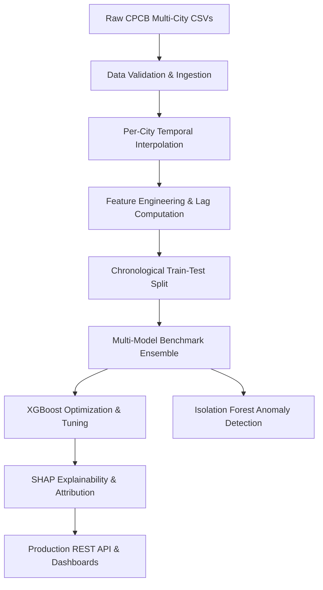

# AI-Powered Air Quality Forecasting Architecture

This document describes the high-level system architecture for the CPCB Air Quality Index (AQI) forecasting pipeline.

## 1. System Pipeline Overview

## 2. Core Functional Modules

1. **Data Ingestion (`src/data/loader.py`)**: Schema verification, timestamp parsing, station-level telemetry integrity checks.
2. **Data Cleaning (`src/data/cleaner.py`)**: Per-station linear temporal interpolation preventing cross-station signal leakage.
3. **Feature Engineering (`src/features/engineer.py`)**: 1-day, 3-day, and 7-day lagged AQI predictors, rolling 3-day mean and volatility statistics.
4. **Model Suite (`src/models/`)**: Baseline Linear/Ridge estimators, Random Forest ensemble, XGBoost with early stopping, and Isolation Forest.
5. **Explainability (`src/explainability/shap_explainer.py`)**: TreeExplainer calculating global feature importance and local waterfall attribution for severe smog events.
